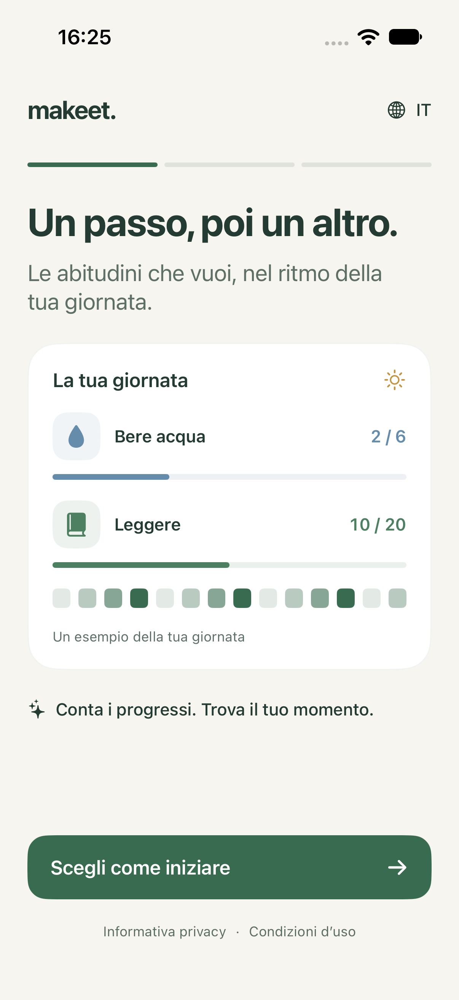
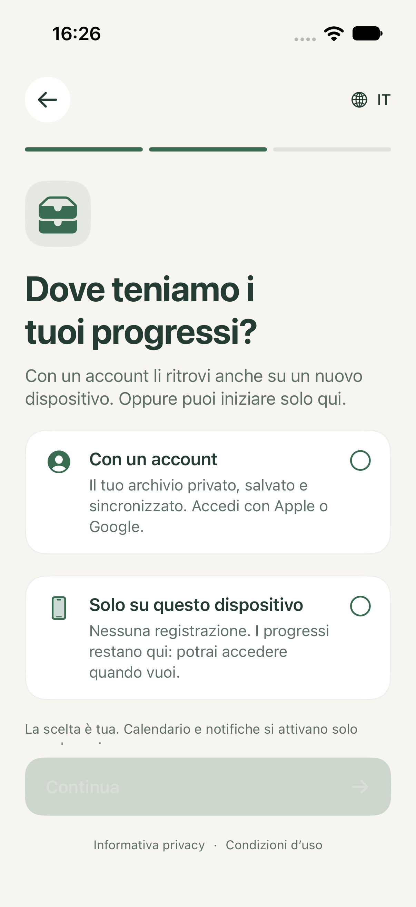

# Makeet

A native, quantitative habit tracker that makes room for habits in your calendar.

Makeet starts from the clarity of a habit grid and adds timestamped quantities, deeper statistics, and an explainable scheduling assistant. The app and widgets support Italian, English, French, German, and Spanish. Choose a language in the app or follow the device language. iOS 17 and macOS 14 or later are supported.

 

Screenshots show sample data.

An Android developer candidate is available in `android/`, implemented with Kotlin and Jetpack Compose against the same Go service. It supports Android 8.0 and newer, targets Android 16, and uses the same entirely free product model and five languages. Google Play distribution and real Android provider validation are still pending. See [Android architecture and release gates](docs/android.md). Username/password access and explicit credential enrollment for existing accounts are implemented in the shared service and both native clients; activation and native release verification are tracked in [password accounts](docs/password-accounts.md).

## Product target

Makeet is intended for public use with open self-service registration and private data for each account. Its custom Go backend runs independently of the native app on the owner's Mac Pro, with Apple/Google identities and verified username/password access through the same account authority. Identity verification, session rotation, account data deletion, and account-scoped sync APIs have HTTP/database integration coverage. The pre-release website and API are deployed at [makeet.app](https://makeet.app) and [api.makeet.app](https://api.makeet.app/healthz). The native account adapter uses Keychain sessions, separate account archives and durable retry/conflict handling. Apple iOS and Google providers are enabled for live validation. An Apple exchange, session restoration and account settings with a successful empty sync were verified on a physical iPhone; the owner also confirmed a fresh Apple sign-in succeeds in TestFlight. Google and multi-device progress checks remain release requirements. See [the backend](backend/README.md) and [account requirements](docs/integrations.md#public-account-architecture-requirements).

## Current foundation

- Create and edit habits with selected weekdays, an SF Symbol or emoji, target, unit, increment, preferred hour, start date and session duration.
- Adjust today's quantity with minus on the left and plus on the right, choose whether minus stops at zero or permits a negative balance, continue beyond a target, inspect timestamps, and undo individual registrations.
- Browse a combined monthly heatmap, inspect calendar events and correct past-day quantities without changing other days.
- Review 7-day, 28-day, and 12-week quantities, daily averages, completion rates, current/best streaks, activity intensity, and hourly distributions.
- Get local scheduling proposals that avoid calendar conflicts, other proposals, past hours, and completed goals. With sufficient history, proposals use the most frequently logged hour in the previous 28 days.
- Connect device calendars through EventKit, select availability sources and a writable destination, and review individual events or batches covering up to 28 days before creating them. Planned events never mark habits as complete.
- Use interactive small and medium WidgetKit extensions for iOS and native macOS, backed by the same on-device SwiftData store.
- Archive and restore habits while retaining history, or permanently delete a habit and its registrations with confirmation. Optional cleanup removes its future linked Makeet calendar blocks.
- Track minimum goals or limits, including a zero target for habits to avoid. Explicit zero confirmation counts a successful day; excess occurrences are shown as malus.
- Export device progress and available server records as JSON, including offline.
- Use tracking, calendar planning and private account synchronization free. Subscriptions and in-app purchase prompts are disabled for this release.
- Follow a five-language welcome that explains progress and asks explicitly between an Apple/Google account and local storage. No option is preselected and no local archive uploads automatically. Calendar and notification permissions remain optional.
- Personalize a private account profile with a display name and photo, shown in Account and Today. Choose a photo with the system picker; a first Google sign-in can import a profile when Makeet has none. Profile revisions prevent silent overwrites between devices. Demo data remains an explicit, labeled choice.

 

## Integration status

| Integration | State |
| --- | --- |
| Offline habit persistence | Implemented; tested across separate contexts and store reopening |
| Public registration and accounts | Apple iOS and Google providers enabled for live validation |
| Account-based synchronization | Go sync API and native durable sync adapter implemented/tested; live multi-device validation pending |
| App/widget storage | App Group configuration and shared SwiftData schema implemented |
| Push notifications | Authenticated encrypted device registration, APNs sender, optional daily reminders and receipts implemented/tested; Sandbox configured; real delivery and production credentials pending |
| EventKit calendars | Availability reading, change refresh, calendar selection, conflict recheck, confirmed event creation implemented; validated using an isolated Simulator calendar |
| Google through system calendars | Available through EventKit when the Google account is configured in device settings; actual provider synchronization belongs to the OS |
| iCloud across devices | CloudKit configuration path prepared; disabled by default; requires Apple capability provisioning and multi-device validation |
| Direct Google connection | Not implemented; requires OAuth and incremental Calendar API sync |
| Subscription billing | Unavailable in the current free release; retained purchase code is isolated and disabled in production |
| Scheduling assistant | Local deterministic engine; no external LLM, autonomous background execution, or hidden calendar writes |
| Widget runtime | Builds for iOS and macOS; real Home Screen/desktop interaction still requires end-to-end validation |

This is an initial product foundation, not an App Store release or a claim of verified cloud synchronization. See [the product model](docs/product.md) and [integration design](docs/integrations.md).

## Run

Open `Makeet.xcodeproj` in Xcode, select the `Makeet` scheme, and run on an iPhone Simulator. For the Mac companion, use `MakeetMac`.

For physical devices, select your Apple development team and register the App Group `group.org.turinglabs.makeet` for the app and both widget extensions. Signing identifiers are intentionally not tied to a personal team.

The project is generated from `project.yml` using [XcodeGen](https://github.com/yonaskolb/XcodeGen). After changing target configuration:

```sh
xcodegen generate
```

Run domain and persistence integration tests:

```sh
swift test --disable-sandbox
```

Run iOS UI tests using an installed simulator:

```sh
xcodebuild -project Makeet.xcodeproj -scheme Makeet \
  -destination 'platform=iOS Simulator,name=iPhone 16 Pro' test
```

`--demo` opts into sample data in an empty archive. `--ui-testing` uses an isolated in-memory archive. Neither is enabled for normal launches. Screenshots used for product review must identify demo content.

## Repository map

- `Core/`: platform-independent day boundaries, statistics, scheduling and sync protocol/ledger.
- `Accounts/`: HTTP account client, serialized session rotation and Keychain storage.
- `Shared/`: SwiftData models, storage configuration, colors, and UI tokens.
- `App/`: shared SwiftUI iOS/macOS interface and EventKit adapter.
- `Widget/`: interactive WidgetKit extension and logging intent.
- `android/`: native Android client, account-scoped SQLite persistence, calendar adapter, widget and native tests.
- `Tests/`: domain and disk-persistence tests.
- `CalendarTests/`: Simulator-hosted EventKit integration and notification permission/registration tests.
- `UITests/`: iOS creation, logging, undo, navigation, and connection-state checks.
- `backend/`: Go HTTP service, SQLite persistence, identity verification, and integration tests.
- `DESIGN.md`: visual language and interaction rules.

Calendar integration tests use a temporary calendar and skip on physical devices or when access is not granted. To explicitly enable the Simulator test, grant calendar access to the host and select that test target:

```sh
xcrun simctl privacy booted grant calendar org.turinglabs.makeet
xcodebuild -project Makeet.xcodeproj -scheme Makeet \
  -destination 'platform=iOS Simulator,name=iPhone 16 Pro' \
  -only-testing:MakeetCalendarTests test
```

Test permission setup is not a substitute for validating the real user consent screen before release.

## Public website

The Go service embeds a responsive pre-release website in `backend/internal/site/`, with Italian, English, French, German, and Spanish content. It uses system typography and a labeled screenshot of the native app. Support is available at [makeet.app/en/support](https://makeet.app/en/support). No sign-up or download button is shown before those services are ready.

Privacy, terms and account deletion instructions are published in five languages. The controller identity is runtime-only and appears exclusively in the privacy notice; primary hosting is in Italy. Daily restricted SQLite backups rotate within 30 days and an isolated restore drill passed. Real account lifecycle verification remains a release requirement. Apple App Store Connect has a Makeet iOS record, version 1.0 in preparation; this does not mean the app has been submitted or approved.

See [release readiness](docs/release-readiness.md) for the audited App Store preparation and remaining real-provider/device validation.
