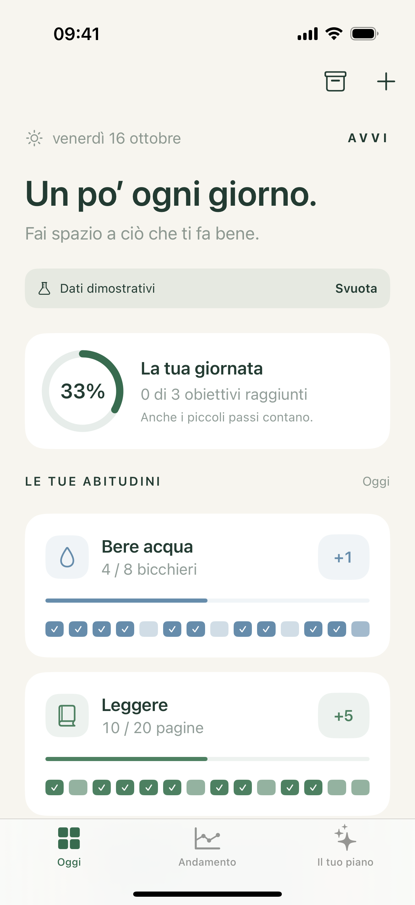
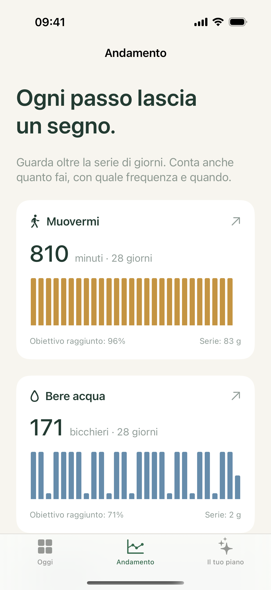

# Avvi

A native, quantitative habit tracker that makes room for habits in your calendar.

Avvi starts from the clarity of a habit grid and adds timestamped quantities, deeper statistics, and an explainable scheduling assistant. The initial interface is Italian. iOS 17 and macOS 14 or later are supported.

 

Screenshots show sample data.

## Product target

Avvi is intended for public use with open self-service registration and private data for each account. When a backend is needed, the preferred host is the owner's Mac Pro. The current foundation has no account service or live registration endpoint; these requirements guide the next implementation stage. See [the account and synchronization requirements](docs/integrations.md#public-account-architecture-requirements).

## Current foundation

- Create daily habits with a target, unit, increment, preferred hour, and session duration.
- Log multiple times per day, continue beyond a target, inspect timestamps, and undo individual registrations.
- Review 7-day, 28-day, and 12-week quantities, daily averages, completion rates, current/best streaks, activity intensity, and hourly distributions.
- Get local scheduling proposals that avoid calendar conflicts, other proposals, past hours, and completed goals. With sufficient history, proposals use the most frequently logged hour in the previous 28 days.
- Connect device calendars through EventKit, select availability sources and a writable destination, and review each proposed event before creating it. Planned events never mark habits as complete.
- Use interactive small and medium WidgetKit extensions for iOS and native macOS, backed by the same on-device SwiftData store.
- Archive and restore habits while retaining their history.
- Start with an empty account-free archive or explicitly explore labeled demo data.

## Integration status

| Integration | State |
| --- | --- |
| Offline habit persistence | Implemented; tested across separate contexts and store reopening |
| Public registration and accounts | Required for the public product; not implemented yet |
| Account-based synchronization | Next implementation stage; no server deployed |
| App/widget storage | App Group configuration and shared SwiftData schema implemented |
| EventKit calendars | Availability reading, change refresh, calendar selection, conflict recheck, confirmed event creation implemented; validated using an isolated Simulator calendar |
| Google through system calendars | Available through EventKit when the Google account is configured in device settings; actual provider synchronization belongs to the OS |
| iCloud across devices | CloudKit configuration path prepared; disabled by default; requires Apple capability provisioning and multi-device validation |
| Direct Google connection | Not implemented; requires OAuth and incremental Calendar API sync |
| Scheduling assistant | Local deterministic engine; no external LLM, autonomous background execution, or hidden calendar writes |
| Widget runtime | Builds for iOS and macOS; real Home Screen/desktop interaction still requires end-to-end validation |

This is an initial product foundation, not an App Store release or a claim of verified cloud synchronization. See [the product model](docs/product.md) and [integration design](docs/integrations.md).

## Run

Open `Avvi.xcodeproj` in Xcode, select the `Avvi` scheme, and run on an iPhone Simulator. For the Mac companion, use `AvviMac`.

For physical devices, select your Apple development team and register the App Group `group.org.turinglabs.avvi` for the app and both widget extensions. Signing identifiers are intentionally not tied to a personal team.

The project is generated from `project.yml` using [XcodeGen](https://github.com/yonaskolb/XcodeGen). After changing target configuration:

```sh
xcodegen generate
```

Run domain and persistence integration tests:

```sh
swift test --disable-sandbox
```

Run iOS UI tests using an installed simulator:

```sh
xcodebuild -project Avvi.xcodeproj -scheme Avvi \
  -destination 'platform=iOS Simulator,name=iPhone 16 Pro' test
```

`--demo` opts into sample data in an empty archive. `--ui-testing` uses an isolated in-memory archive. Neither is enabled for normal launches. Screenshots used for product review must identify demo content.

## Repository map

- `Core/`: platform-independent day boundaries, statistics, and scheduling.
- `Shared/`: SwiftData models, storage configuration, colors, and UI tokens.
- `App/`: shared SwiftUI iOS/macOS interface and EventKit adapter.
- `Widget/`: interactive WidgetKit extension and logging intent.
- `Tests/`: domain and disk-persistence tests.
- `CalendarTests/`: Simulator-only EventKit creation, idempotency, and conflict tests.
- `UITests/`: iOS creation, logging, undo, navigation, and connection-state checks.
- `DESIGN.md`: visual language and interaction rules.

Calendar integration tests use a temporary calendar and skip on physical devices or when access is not granted. To explicitly enable the Simulator test, grant calendar access to the host and select that test target:

```sh
xcrun simctl privacy booted grant calendar org.turinglabs.avvi
xcodebuild -project Avvi.xcodeproj -scheme Avvi \
  -destination 'platform=iOS Simulator,name=iPhone 16 Pro' \
  -only-testing:AvviCalendarTests test
```

Test permission setup is not a substitute for validating the real user consent screen before release.
